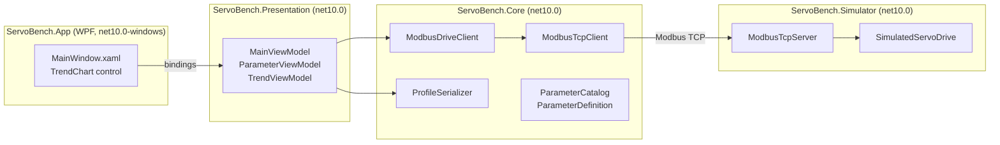

# ServoBench

[](https://github.com/AnirudhBabu/ServoBench/actions/workflows/ci.yml)

A WPF configuration and tuning tool for servo drives, the kind of desktop software that ships with industrial drives and motion controllers. It talks Modbus TCP to a drive, edits and validates its parameters, runs the motor, plots speed and current live, and saves configurations as profiles.

No hardware needed: the repo includes a simulated servo drive with a real PI speed loop, current limiting, a thermal model and protection faults, so tuning changes behave the way they would on a bench.

<!-- Add a screenshot of the main window here:  -->

## What it does

- **Connects over Modbus TCP** with a hand-written client (function codes 0x03, 0x06 and 0x10), transaction-id checking, timeouts and clean recovery from a dropped link.
- **Parameter grid** grouped by Motion, Limits, Speed loop tuning and Nameplate. Every value is validated against range and resolution as you type, scaled from raw registers to engineering units, and shown in your regional number format.
- **Safe editing.** Changed rows are highlighted, invalid ones flagged, and nothing reaches the drive until you press *Write to drive*. Live polling never overwrites a value you are editing. If the drive rejects one value, the rest still write and the rejected row is marked.
- **Run the motor**: enable, disable, send a speed setpoint, stop, reset faults. Status badges show Enabled, At speed, Current limit and Fault.
- **Live trend** of speed, setpoint and current at 10 Hz, drawn by a custom WPF control. Freeze it to study a step response.
- **Profiles**: save the drive's configuration to JSON and load it onto another drive. Loading stages the values for review instead of writing them blindly; unknown, read-only and out-of-range entries are skipped with a reason.

## Architecture



| Project | Responsibility |
| --- | --- |
| `ServoBench.Core` | Modbus framing and client, the drive's parameter table with scaling and validation, snapshots, profiles. No UI. |
| `ServoBench.Simulator` | Console app exposing a simulated drive on Modbus TCP. Also referenced by the tests. |
| `ServoBench.Presentation` | View models (MVVM with CommunityToolkit.Mvvm). Plain `net10.0`, no WPF reference. |
| `ServoBench.App` | WPF views, dependency injection, file dialogs, the polling timer and the trend chart. |

## Design decisions

- **View models do not reference WPF.** Dialogs, file access and drive connections sit behind small interfaces (`IDriveClientFactory`, `IProfileFileService`), so every view model behaviour is unit tested, and CI runs those tests on Linux as well as Windows.
- **Validation lives with the parameter definition.** The same `ParameterDefinition` rules drive the grid's error messages (via `INotifyDataErrorInfo`), the client's pre-write check and the simulator's firmware-side check, so they cannot drift apart.
- **The Modbus client is hand-written** rather than taken from a library, to show the protocol: MBAP header, big-endian registers, exception responses, and why a timeout must close the socket (the stream is no longer aligned on a frame).
- **Two kinds of failure are kept apart.** A Modbus exception response means the drive refused a request and the link is fine; an I/O error or timeout means the link is gone. The UI handles them differently.
- **Multi-register writes on the simulator are all or nothing**, matching how drive firmware protects itself from half-applied configurations.

## Getting started

Requires the [.NET 10 SDK](https://dotnet.microsoft.com/download) and Windows for the WPF app. The simulator and tests also run on Linux and macOS.

```bash
# 1. Start the simulated drive (listens on 127.0.0.1:1502)
dotnet run --project src/ServoBench.Simulator

# 2. In another terminal, start the app and press Connect
dotnet run --project src/ServoBench.App

# Run the tests
dotnet test ServoBench.slnx
```

### Try a tuning exercise

1. Connect, press **Enable**, send **1500** rpm and watch the trend.
2. Set *Speed loop Ki* to `0` and write it. Under friction and load the motor settles around 1290 rpm: proportional control alone leaves a steady-state error. Put Ki back to `5.00` and the error disappears.
3. Set *Acceleration time* to `10` ms so setpoint changes become steps, then set *Kp* to `0.050` and *Ki* to `2.00`. Stop, then send 1500 rpm again: the speed overshoots by about 45% and rings for a few seconds. Tick **Freeze** to study it.
4. Now try *Kp* `2.000` and *Ki* `5.00`. The same step lands on 1500 rpm with no overshoot.
5. Go back to the ringing gains, set *Maximum speed* to `1000` and step to 1000 rpm. The overshoot passes 110% of the limit and the drive trips an **Overspeed** fault. Reset it, restore the good gains, and save the result as a profile.

## Register map

All values are 16-bit holding registers, unit id 1. Signed values are two's complement.

| Address | Name | Units / scale | Access |
| --- | --- | --- | --- |
| 0 | Control word (bit 0 enable, bit 7 fault reset) | bits | R/W |
| 1 | Status word (enabled, faulted, at speed, current limited) | bits | R |
| 2 | Fault code (1 overtemperature, 2 overspeed) | code | R |
| 10 | Speed setpoint | rpm, signed | R/W |
| 11 | Maximum speed | rpm | R/W |
| 12 | Acceleration time (0 to rated speed) | ms | R/W |
| 13 | Deceleration time | ms | R/W |
| 14 | Current limit | 0.1 A | R/W |
| 15 | Speed loop Kp | 0.001 | R/W |
| 16 | Speed loop Ki | 0.01 | R/W |
| 20 | Actual speed | rpm, signed | R |
| 21 | Motor current | 0.01 A, signed | R |
| 22 | DC bus voltage | 0.1 V | R |
| 23 | Drive temperature | 0.1 °C, signed | R |
| 30 | Rated speed | rpm | R |
| 31 | Rated current | 0.1 A | R |

## Tests

xUnit covers the protocol and the behaviour that matters on a real machine:

- **Modbus framing** against byte layouts from the specification, including exception responses and malformed frames.
- **Parameter scaling and validation**: two's complement, resolution, float-noise at boundaries, regional number formats.
- **Simulator physics**: ramp timing, current-limited acceleration, integral action removing steady-state error, overspeed and overtemperature trips, firmware-style write validation.
- **Round trips over real loopback TCP** between the client and the simulator, including several clients sharing one drive.
- **View models**: edits never overwritten by polling, only changed rows written, rejected values flagged, lost connections handled, profiles staged rather than written.
- **End to end**: the real view model tuning and running the simulated drive over TCP.

## Roadmap

- Step-response metrics on the trend (rise time, overshoot, settling time)
- Write-and-verify for profiles, with a diff view before applying
- Modbus RTU over serial alongside TCP
- Parameter descriptions loaded from a device description file instead of code

## Author

Built by Anirudh Babu. MIT licensed.
